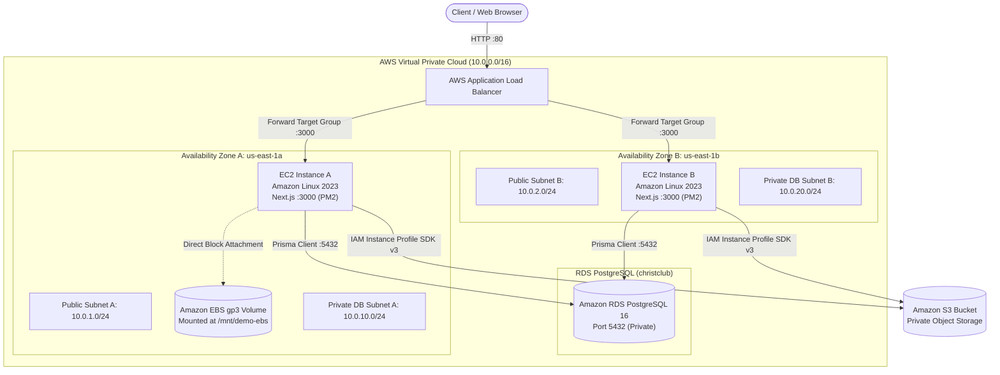

# Christ Club Online Store
> **AWS-Hosted Modern Order Management Web Application**  
> *Coursework Project for MSc AIML: Cloud Computing for AI*

An enterprise-grade, production-minded Order Management web application built to master and demonstrate four core AWS cloud infrastructure requirements:
1. **Multi-AZ Compute:** Deployment on two Amazon Linux EC2 instances in separate Availability Zones (`us-east-1a` and `us-east-1b`).
2. **Traffic Distribution & High Availability:** Internet-facing AWS Application Load Balancer (ALB) with automated health probes and failover routing.
3. **Managed Relational Database:** Amazon RDS for PostgreSQL in private subnets, queried via Prisma ORM and direct `psql`.
4. **Hybrid Storage:** Amazon EBS gp3 block storage attached and mounted to an EC2 instance filesystem, paired with an Amazon S3 private object storage bucket accessed via IAM Role credentials.

---

## 1. Cloud Architecture Diagram



---

## 2. Technology Stack

- **Frontend & Server:** Next.js 14 (React 18, TypeScript, App Router).
- **Styling & UI:** Tailwind CSS, Lucide icons, responsive layout with sidebar and telemetry cards.
- **ORM & Data Layer:** Prisma ORM, PostgreSQL (Amazon RDS), and seamless local store fallback.
- **AWS Compute:** 2x Amazon Linux 2023 EC2 instances in separate Availability Zones.
- **Load Balancing:** AWS Application Load Balancer with target health checking against `/api/health`.
- **Storage:** Amazon EBS gp3 (formatted as `ext4`, mounted at `/mnt/demo-ebs`) & Amazon S3 private bucket.
- **Security:** Security Groups (ALB -> EC2 -> RDS), EC2 IAM Instance Profile with least-privilege policies, IMDSv2 with short timeout.
- **Testing:** Vitest automated test suite and PowerShell/Bash deployment verification scripts.

---

## 3. Assignment Documentation & Guides

For your coursework evaluation and manual cloud deployment, consult these specialized guides:
- [**docs/manual-aws-setup-guide.md**](file:///c:/Documents/Projects/CollegeClubStore/docs/manual-aws-setup-guide.md) — Comprehensive, click-by-click manual AWS Console tutorial for VPC, EC2, RDS, EBS, S3, ALB, and Security Groups.
- [**docs/evidence-matrix.md**](file:///c:/Documents/Projects/CollegeClubStore/docs/evidence-matrix.md) — Requirements-to-Evidence Matrix mapping all 4 assignment criteria to AWS resources, files, commands, and screenshots for your report.
- [**docs/github-guide.md**](file:///c:/Documents/Projects/CollegeClubStore/docs/github-guide.md) — Step-by-step instructions for pushing this repository to your personal GitHub account.
- [**scripts/sample-queries.sql**](file:///c:/Documents/Projects/CollegeClubStore/scripts/sample-queries.sql) — Demonstration SQL queries for listing, filtering, calculating sum, and grouping by status.

---

## 4. Local Testing on Your Laptop

You can run and test the complete application locally on your Windows/Mac/Linux laptop before deploying to AWS.

### 4.1 Prerequisites
- Node.js LTS (v18, v20, or v22+)
- Git

### 4.2 Installation & Setup
```bash
# 1. Clone or open the project folder
cd "c:xxxxxxxx\Projects\CollegeClubStore"

# 2. Install dependencies
npm install

# 3. Generate Prisma client
npx prisma generate

# 4. Run automated test suite
npm test
```

### 4.3 Start Local Server
```bash
npm run dev
```
Open **[http://localhost:3000](http://localhost:3000)** in your browser:
- **Dashboard (`/`):** Summary metrics (Total Orders, Revenue, Pending, Completed).
- **Orders (`/orders`):** Order directory, status filter, and order creation form.
- **Storage Demo (`/storage`):** Test EBS block storage and simulated S3 object upload.
- **Infrastructure (`/infrastructure`):** Telemetry status, liveness vs readiness checks, and interactive traffic distribution simulator.

### 4.4 Automated Local Verification Check
In a separate terminal window, run the automated checker:
```powershell
powershell -ExecutionPolicy Bypass -File scripts/verify-deployment.ps1
```

---

## 5. Summary of API Endpoints

| Method | Endpoint | Description |
|---|---|---|
| `GET` | `/api/health` | Lightweight liveness probe returning HTTP 200 (used by ALB Target Group) |
| `GET` | `/api/ready` | Readiness probe verifying PostgreSQL database connectivity & latency |
| `GET` | `/api/instance` | Reports EC2 instance ID (via IMDSv2), AZ, and hostname |
| `GET` | `/api/orders` | Lists orders (supports `?status=pending|paid|shipped` filter) |
| `POST` | `/api/orders` | Creates a new order with Zod schema validation |
| `GET` | `/api/orders/[id]` | Retrieves an individual order by ID |
| `GET` | `/api/storage/status` | Diagnostic health of EBS mount point and S3 bucket |
| `POST` | `/api/storage/ebs` | Safely writes sample file (`sample-order-file.txt`) to EBS mounted filesystem |
| `POST` | `/api/storage/s3` | Uploads sample file (`sample-s3-file.txt`) to S3 bucket via AWS SDK v3 |

---

## 6. Verification of the 4 AWS Requirements

### Requirement 1: Multi-AZ EC2 Compute
- Launch 2 EC2 instances: `ChristClub-Instance-A` in `us-east-1a` and `ChristClub-Instance-B` in `us-east-1b`.
- Run application with PM2: `pm2 start npm --name "christ-store" -- start`.
- Inspect IMDSv2 metadata at `/api/instance`.

### Requirement 2: Application Load Balancer
- Create Target Group on port 3000 with health checks on `/api/health`.
- Create internet-facing ALB on port 80 forwarding to the Target Group.
- Run the traffic distribution script from your laptop:
  ```powershell
  powershell -File scripts/verify-alb-traffic.ps1 -TargetUrl http://<ALB_DNS> -RequestCount 30
  ```
- **Safe Failover Test:**
  1. On Instance A: `pm2 stop christ-store`.
  2. ALB marks Instance A as unhealthy within 30 seconds.
  3. Re-run script: 100% of traffic routes seamlessly to Instance B.
  4. On Instance A: `pm2 start christ-store` restores healthy status.

### Requirement 3: Amazon RDS PostgreSQL
- Launch private PostgreSQL instance in `christ-club-vpc`.
- Security group allows port 5432 **only** from `ec2-sg`.
- From EC2 via SSM Session Manager:
  ```bash
  sudo dnf install -y postgresql15
  psql -h <RDS_ENDPOINT> -U postgres -d christclub -f scripts/sample-queries.sql
  ```

### Requirement 4: EBS Block Storage & S3 Object Storage
- **EBS (gp3):**
  1. Create 10GB gp3 volume in `us-east-1a` and attach to Instance A.
  2. Mount persistently using UUID in `/etc/fstab` via `sudo bash scripts/setup-ebs.sh`.
  3. Verify with `df -h /mnt/demo-ebs` and `cat /mnt/demo-ebs/sample-order-file.txt`.
- **S3 (Object):**
  1. Create private bucket with Block Public Access and SSE-S3 encryption.
  2. Upload sample file via web app `/storage` or `POST /api/storage/s3`.
  3. Verify using AWS CLI: `aws s3 ls s3://<BUCKET_NAME>/`.

---

## 7. Cost Considerations & Cleanup

To avoid unintended AWS billing after completing your demonstration:
1. Terminate both EC2 instances.
2. Delete the Application Load Balancer and Target Group.
3. Delete the attached EBS volume.
4. Delete the RDS database instance (uncheck final snapshot).
5. Empty and delete the S3 bucket.
6. Delete the VPC (`christ-club-vpc`).
=======
# christ-club-online-store
College Club Online Store 

